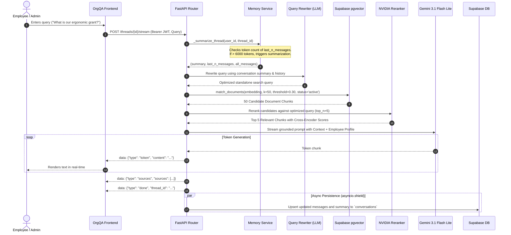
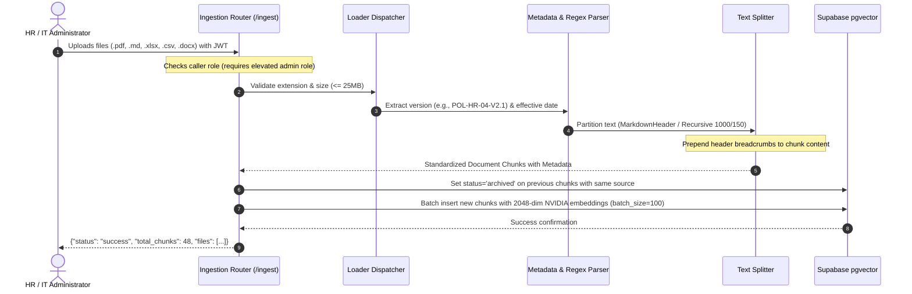

# OrgQA — Enterprise Policy Intelligence & Grounded RAG Platform

[](https://python.org)
[](https://fastapi.tiangolo.com)
[](https://langchain.com)
[](https://supabase.com)
[](https://build.nvidia.com)
[](https://deepmind.google/technologies/gemini)
[](LICENSE)

OrgQA is an enterprise-grade Retrieval-Augmented Generation (RAG) platform designed to synthesize, query, and govern corporate knowledge across HR, IT Information Security, Legal, Finance, and Workplace Operations. 

Unlike generic conversational bots, OrgQA implements a **strict dual-stage retrieval pipeline with reranking**, **temporal version precedence**, **active role-based access control (RBAC)**, **rolling conversational memory compression**, and **zero-hallucination guardrails** that cite exact document sections, spreadsheets, and policy revisions down to the source chunk.

---

## Table of Contents

- [1. Executive Architecture Overview](#1-executive-architecture-overview)
- [2. System Flow & Sequence Diagrams](#2-system-flow--sequence-diagrams)
- [3. Core Technical Pillars](#3-core-technical-pillars)
  - [3.1 Multi-Format Ingestion & Metadata Injection](#31-multi-format-ingestion--metadata-injection)
  - [3.2 Dual-Stage Vector Search & Cross-Encoder Reranking](#32-dual-stage-vector-search--cross-encoder-reranking)
  - [3.3 Contextual Query Expansion & Resolution](#33-contextual-query-expansion--resolution)
  - [3.4 Rolling Token Summarization & Memory Compression](#34-rolling-token-summarization--memory-compression)
  - [3.5 Grounded Generation, Injection Defense & Temporal Rules](#35-grounded-generation-injection-defense--temporal-rules)
  - [3.6 Resilient Server-Sent Events (SSE) Streaming](#36-resilient-server-sent-events-sse-streaming)
- [4. Frontend Design System & Architecture](#4-frontend-design-system--architecture)
- [5. Database Schema & Vector Indices](#5-database-schema--vector-indices)
- [6. API Reference](#6-api-reference)
- [7. Evaluation & Benchmark Framework](#7-evaluation--benchmark-framework)
- [8. Repository Structure](#8-repository-structure)
- [9. Setup & Deployment](#9-setup--deployment)

---

## 1. Executive Architecture Overview

```
                      ┌──────────────────────────────────────────────┐
                      │             OrgQA Client (SPA)               │
                      │  Light/Dark Monochromatic Executive Console   │
                      └───────┬──────────────────────────────▲───────┘
                              │                              │
                     HTTP / SSE (JWT Bearer)         Server-Sent Events
                              │                              │
                              ▼                              │
┌────────────────────────────────────────────────────────────┴───────────────────────────────────────┐
│ FastAPI Application Core (main.py)                                                                 │
│                                                                                                    │
│  ┌───────────────────────────────┐                  ┌───────────────────────────────────────────┐  │
│  │   Auth & RBAC Middleware      │                  │         Health & Observability            │  │
│  │ (get_current_user / elevated) │                  │       (/health, LangSmith Tracing)        │  │
│  └──────────────┬────────────────┘                  └───────────────────────────────────────────┘  │
│                 │                                                                                  │
│                 ├─────────────────────────────────────────────────┐                                │
│                 │ [POST /threads/{id}/stream]                     │ [POST /ingest]                 │
│                 ▼                                                 ▼                                │
│  ┌───────────────────────────────┐                  ┌───────────────────────────────────────────┐  │
│  │      Chat & Query Engine      │                  │       Multi-Format Ingest Engine          │  │
│  │       (routers/chat.py)       │                  │           (routers/ingest.py)             │  │
│  │                               │                  │                                           │  │
│  │ 1. Memory Token Check         │                  │ 1. Multipart & Extension Validation       │  │
│  │ 2. Query Rewriter (LLM)       │                  │ 2. Format Dispatcher (PDF/MD/XLSX/CSV...) │  │
│  │ 3. Vector Retrieval (NVIDIA)  │                  │ 3. Header & Metadata Regex Extractor      │  │
│  │ 4. Cross-Encoder Reranker     │                  │ 4. Two-Stage Splitter (1000/150)          │  │
│  │ 5. Grounded Generator (LLM)   │                  │ 5. Archive Old Chunks & Batch Upsert      │  │
│  └──────────────┬────────────────┘                  └─────────────────────┬─────────────────────┘  │
└─────────────────┼─────────────────────────────────────────────────────────┼────────────────────────┘
                  │                                                         │
                  ▼                                                         ▼
┌────────────────────────────────────────────────────────────────────────────────────────────────────┐
│ Storage, Vector Database & Inference Providers                                                     │
│                                                                                                    │
│  ┌─────────────────────────────────────────┐      ┌─────────────────────────────────────────────┐  │
│  │          Supabase (PostgreSQL)          │      │                 NVIDIA NIM                  │  │
│  │  - pgvector: documents (HNSW index)     │      │  - Embeddings: nemotron-3-embed-1b          │  │
│  │  - RPC: match_documents (Cosine)        │      │  - Reranker: llama-nemotron-rerank-vl-1b-v2 │  │
│  │  - conversations (JSONB chat history)   │      └─────────────────────────────────────────────┘  │
│  │  - users (RBAC & employee profiles)     │      ┌─────────────────────────────────────────────┐  │
│  └─────────────────────────────────────────┘      │              Google Generative AI           │  │
│                                                   │  - Model: Gemini 3.1 Flash Lite             │  │
│                                                   └─────────────────────────────────────────────┘  │
└────────────────────────────────────────────────────────────────────────────────────────────────────┘
```

---

## 2. System Flow & Sequence Diagrams

### 2.1 Chat Query Lifecycle (RAG with Dynamic Reranking & Streaming)



### 2.2 Document Ingestion Lifecycle



---

## 3. Core Technical Pillars

### 3.1 Multi-Format Ingestion & Metadata Injection
Enterprise policies do not live in one file format. OrgQA incorporates a custom ingestion engine ([`services.py`](services.py)) supporting **9 file types** with format-specific parsing strategies:

| Extension | Loader Implementation | Partitioning Strategy | Injected Metadata |
|:---|:---|:---|:---|
| `.pdf` | `PyMuPDFLoader` | High-fidelity page extraction | `source`, `page`, `version`, `effective_date`, `status` |
| `.md`, `.markdown` | `UnstructuredMarkdownLoader` | `MarkdownHeaderTextSplitter` (`#`, `##`, `###`) | `Header 1`, `Header 2`, `Header 3`, `source`, `version`, `effective_date` |
| `.xlsx`, `.xls` | `StructuredExcelLoader` | Sheet & cell hierarchy retention | `sheet_name`, `row_index`, `source`, `version`, `effective_date` |
| `.csv`, `.tsv` | `CSVLoader` | Row-level tabular isolation | `row`, `source`, `version`, `effective_date` |
| `.docx`, `.doc` | `UnstructuredWordDocumentLoader` | Structural document sections | `source`, `version`, `effective_date`, `status` |

#### Header & Version Extraction Regex
Every ingested document is parsed via regex to extract corporate policy identifiers and effective dates:
```python
version_match = re.search(r"(?:Version|V|POL-[\w-]+-V)[\s:]*([0-9.]+)", text, re.IGNORECASE)
date_match = re.search(r"Effective Date:\s*([^\n\r*]+)", text, re.IGNORECASE)
```
Every chunk content is injected with top-level provenance tags:
```
Document: it_security_policy.pdf | Effective Date: 2026-01-01 | Version: 2.1
[Chunk Body Text...]
```

#### Chunk Archival Protocol
When an updated document is uploaded with an identical filename, existing chunks in Supabase are marked `status = 'archived'`. Vector queries filter exclusively for `status = 'active'`, preventing out-of-date policy contamination while preserving historical data.

---

### 3.2 Dual-Stage Vector Search & Cross-Encoder Reranking
Single-stage vector retrieval frequently suffers from low precision in enterprise documents where multiple policies contain similar vocabulary (e.g., travel expenses vs. conference grants).

OrgQA utilizes a two-tier retrieval architecture:
1. **First-Stage Semantic Search**: `SupabaseVectorStore` performs an approximate nearest neighbor search using 2048-dimensional vectors from `nvidia/nemotron-3-embed-1b` (`k = 50`, `similarity_threshold = 0.30`).
2. **Second-Stage Cross-Encoder Reranking**: `NVIDIARerank` with `nvidia/llama-nemotron-rerank-vl-1b-v2` re-scores all 50 candidates directly against the query, passing only the **top 5 highest-relevance chunks** to the LLM.

```
Incoming Query ──► [ NVIDIA Embeddings ] ──► [ Supabase pgvector ] (Top 50 Chunks)
                                                        │
                                                        ▼
Final Context (Top 5) ◄── [ NVIDIA Cross-Encoder Reranker (Top 5) ]
```

---

### 3.3 Contextual Query Expansion & Resolution
Pronouns, conversational shorthand, and multi-turn references (e.g., *"What about my spouse?"* following a health insurance question) degrade vector search accuracy.

Before querying the vector database, OrgQA routes the conversation history and the latest user query through an optimization chain ([`prompt.py`](prompt.py#L33-L63)):
* Resolves ambiguous references using the conversation summary and recent turns.
* Injects department, role, and operational terminology.
* Outputs a single, self-contained search string (10–40 words) strictly tailored for cosine vector search.

---

### 3.4 Rolling Token Summarization & Memory Compression
Enterprise conversations can span dozens of turns, rapidly exhausting context windows and increasing inference latency.

OrgQA implements an automated **rolling summarization trigger** ([`services.py`](services.py#L116-L173)):
* **Thresholds**: Evaluates `last_n_messages`. If the token count exceeds `MAX_TOKEN_THRESHOLD = 6000`, compression is triggered.
* **Rolling Slice**: Batches older messages exceeding `SUMMARY_TRIGGER_TOKEN_COUNT = 3000` tokens and passes them to `summary_prompt`.
* **State Retention**: Compresses prior facts into a consolidated summary (preserved dates, policy numbers, monetary allowances, role context) while preserving the most recent turn verbatim.
* **Dual Storage**: Supabase stores both `all_messages` (complete auditable transcript) and `last_n_messages` (active working memory).

---

### 3.5 Grounded Generation, Injection Defense & Temporal Rules
The generation system prompt ([`prompt.py`](prompt.py#L65-L138)) enforces strict operational constraints:

1. **Non-Negotiable Grounding**: The model is forbidden from extrapolating or hallucinating. If context is insufficient, it outputs:
   > *"I don't have enough information in the available policy documents to answer that. Please contact HR or the relevant department for assistance."*
2. **Prompt-Injection Defense**: System instructions explicitly neutralize any prompt injection payloads contained within retrieved policy documents or user messages.
3. **Temporal Precedence**: When overlapping policy dates exist across chunks, the model gives precedence to the **most recent effective date**, disregarding obsolete rules.
4. **Direct Answer First**: The first sentence provides the direct, factual answer immediately without boilerplate introductory phrases (*"Based on the provided documents..."*).
5. **Role-Tailored Adaptation**: Answers automatically prioritize policies relevant to the authenticated user's department, office location, and employment tier.

---

### 3.6 Resilient Server-Sent Events (SSE) Streaming
OrgQA provides real-time token streaming over `text/event-stream` via `POST /threads/{thread_id}/stream`:
* **Producer-Consumer Queue**: Decouples LLM generation (`astream`) from HTTP response delivery via `asyncio.Queue`.
* **Disconnection Resilience**: Wrapped in `asyncio.shield()`. If the user closes the browser tab mid-response, the generation task completes in the background and saves the full conversation to Supabase.
* **Structured Event Payloads**:
  ```json
  data: {"type": "token", "content": "Eligible employees receive "}
  data: {"type": "token", "content": "$1,200 USD"}
  data: {"type": "sources", "sources": [{"source": "benefits.xlsx", "chunk_excerpt": "..."}]}
  data: {"type": "done", "thread_id": "9b1deb4d-3b7d-4bad-9bdd-2b0d7b3dcb6d"}
  ```

---

## 4. Frontend Design System & Architecture

The OrgQA web client ([`index.html`](index.html)) is an ultra-fast, zero-dependency Single-Page Application (SPA) designed with an **architectural, monochromatic executive aesthetic** inspired by Linear, Raycast, and Apple Human Interface Guidelines:

```
┌──────────────────┬─────────────────────────────────────────────────────────┐
│ OrgQA Brand      │ Header: Thread Title | Ingest Policy | Theme | Identity │
├──────────────────┼─────────────────────────────────────────────────────────┤
│ [+ New Query]    │                                                         │
│                  │  [USER]                                                 │
│ Recent Queries   │  What are the core hours and remote office stipends?    │
│ • Collaboration  │                                                         │
│ • Hardware Tier  │  [VERIFIED Compliance Intelligence]                     │
│ • Travel Policy  │  Core collaboration hours are 10:00 AM to 3:00 PM...    │
│                  │                                                         │
│                  │  ▼ Verified Policy Sources (2 Citations)                │
│                  │    [1] hr_handbook.md — Section 2.1                     │
│                  │    [2] employee_benefits.xlsx — Sheet 1                 │
├──────────────────┼─────────────────────────────────────────────────────────┤
│ User Profile     │ [ Input dock: Ask a compliance question...    ] [Query] │
└──────────────────┴─────────────────────────────────────────────────────────┘
```

### Design Highlights:
* **Zero "Vibe-Coded" Blue**: Replaced saturated blue and floating bubbles with an obsidian carbon palette (`#141413` / `#0c0c0e`) and warm gallery stone backgrounds (`#f6f6f5` / `#121214`).
* **Instant Inline Serving**: Served directly by FastAPI at `GET /` with no node build step, bundler, or heavy JS framework overhead.
* **Collapsible Source Citations**: CSS Grid accordion animation (`0fr` ➔ `1fr`) revealing source excerpts, effective dates, and document filenames.
* **Real-time SSE Reader**: Handles UTF-8 streaming, token buffering, dynamic thread auto-scrolling, and Markdown code blocks.
* **Role Switcher & JWT Tester**: Embedded authentication modal allowing seamless switching between mock enterprise profiles (Engineering, HR Admin, IT Ops) or custom Supabase JWT tokens.

---

## 5. Database Schema & Vector Indices

### 5.1 Tables Schema

```sql
-- Enable the pgvector extension
CREATE EXTENSION IF NOT EXISTS vector;

-- 1. Document Chunks & Vector Store
CREATE TABLE IF NOT EXISTS documents (
    id BIGSERIAL PRIMARY KEY,
    content TEXT NOT NULL,
    metadata JSONB NOT NULL DEFAULT '{}'::jsonb,
    embedding VECTOR(2048) NOT NULL
);

-- HNSW Vector Index for sub-millisecond approximate nearest neighbor search
CREATE INDEX IF NOT EXISTS documents_embedding_hnsw_idx 
ON documents USING hnsw (embedding vector_cosine_ops)
WITH (m = 16, ef_construction = 64);

-- JSONB GIN index for metadata filtering (e.g., status='active', source='...')
CREATE INDEX IF NOT EXISTS documents_metadata_gin_idx 
ON documents USING gin (metadata);

-- 2. Persistent Conversations & Memory
CREATE TABLE IF NOT EXISTS conversations (
    thread_id UUID PRIMARY KEY,
    user_id UUID NOT NULL,
    summary TEXT DEFAULT '',
    last_n_messages JSONB DEFAULT '[]'::jsonb,
    all_messages JSONB DEFAULT '[]'::jsonb,
    created_at TIMESTAMPTZ DEFAULT NOW(),
    updated_at TIMESTAMPTZ DEFAULT NOW()
);

CREATE INDEX IF NOT EXISTS conversations_user_id_idx 
ON conversations (user_id, updated_at DESC);

-- 3. Enterprise User Profiles & RBAC
CREATE TABLE IF NOT EXISTS users (
    id UUID PRIMARY KEY REFERENCES auth.users(id) ON DELETE CASCADE,
    email TEXT UNIQUE NOT NULL,
    role TEXT NOT NULL DEFAULT 'employee', -- 'employee', 'hr_admin', 'it_admin', 'super_admin'
    full_name TEXT,
    department TEXT,                      -- 'Engineering', 'HR', 'Finance', 'Legal', 'Sales'
    office_location TEXT,                 -- 'San Francisco', 'New York', 'London', 'Remote'
    employment_type TEXT,                 -- 'Full-Time', 'Contractor', 'Intern'
    is_active BOOLEAN DEFAULT TRUE,
    created_at TIMESTAMPTZ DEFAULT NOW()
);
```

### 5.2 Cosine Similarity RPC (`match_documents`)

```sql
CREATE OR REPLACE FUNCTION match_documents (
    query_embedding VECTOR(2048),
    match_count INT DEFAULT 50,
    filter JSONB DEFAULT '{}'::jsonb
)
RETURNS TABLE (
    id BIGINT,
    content TEXT,
    metadata JSONB,
    similarity FLOAT
)
LANGUAGE plpgsql
AS $$
BEGIN
    RETURN QUERY
    SELECT
        d.id,
        d.content,
        d.metadata,
        1 - (d.embedding <=> query_embedding) AS similarity
    FROM documents d
    WHERE d.metadata @> filter
    ORDER BY d.embedding <=> query_embedding
    LIMIT match_count;
END;
$$;
```

---

## 6. API Reference

### System & Health

#### `GET /health`
Returns system health, database connectivity, and uptime telemetry.
* **Response `200 OK`**:
```json
{
  "status": "healthy",
  "uptime_seconds": 14205.82,
  "vector_store_connected": true
}
```

---

### Conversations & Chat

#### `POST /threads`
Initializes a new persistent conversation thread for the authenticated user.
* **Headers**: `Authorization: Bearer <JWT>`
* **Response `201 Created`**:
```json
{
  "thread_id": "7f8b9c1d-2e3f-4a5b-6c7d-8e9f0a1b2c3d",
  "user_id": "a1b2c3d4-e5f6-7a8b-9c0d-1e2f3a4b5c6d",
  "created_at": "2026-10-16T18:00:00Z",
  "title": null
}
```

#### `GET /threads`
Lists all conversation threads belonging to the authenticated user with titles derived from the first user question or conversation summary.
* **Headers**: `Authorization: Bearer <JWT>`
* **Response `200 OK`**:
```json
[
  {
    "thread_id": "7f8b9c1d-2e3f-4a5b-6c7d-8e9f0a1b2c3d",
    "user_id": "a1b2c3d4-e5f6-7a8b-9c0d-1e2f3a4b5c6d",
    "created_at": "2026-10-16T18:00:00Z",
    "title": "What are the core collaboration h..."
  }
]
```

#### `GET /threads/{thread_id}`
Retrieves complete conversation history, compressed summary, and message transcripts for a thread.
* **Headers**: `Authorization: Bearer <JWT>`

#### `POST /threads/{thread_id}/stream`
Streams answer tokens in real-time via Server-Sent Events (SSE).
* **Headers**: `Authorization: Bearer <JWT>`, `Content-Type: application/json`
* **Request Body**:
```json
{
  "query": "How many days of paid parental leave do full-time employees receive?",
  "stream": true
}
```
* **Event Stream**:
```
data: {"type": "token", "content": "Full-time employees "}
data: {"type": "token", "content": "are entitled to 18 weeks "}
data: {"type": "token", "content": "of 100% paid parental leave [1]."}
data: {"type": "sources", "sources": [{"source": "hr_handbook.md", "chunk_excerpt": "Section 4.3 Parental Leave..."}]}
data: {"type": "done", "thread_id": "7f8b9c1d-2e3f-4a5b-6c7d-8e9f0a1b2c3d"}
```

---

### Ingestion

#### `POST /ingest`
Admin-only multi-file document ingestion endpoint.
* **Headers**: `Authorization: Bearer <JWT>` (Requires role `hr_admin`, `it_admin`, or `super_admin`)
* **Content-Type**: `multipart/form-data`
* **Form Data**: `files` (one or more files: `.pdf`, `.md`, `.xlsx`, `.csv`, `.tsv`, `.docx`)
* **Response `200 OK`**:
```json
{
  "message": "Ingestion complete.",
  "total_chunks": 42,
  "files_processed": [
    "it_information_security_and_compliance_policy.pdf",
    "employee_benefits_and_allowances.xlsx"
  ]
}
```

---

## 7. Evaluation & Benchmark Framework

OrgQA includes an enterprise evaluation suite ([`evaluate_ragas.py`](evaluate_ragas.py)) for assessing RAG quality, factual grounding, and semantic relevance against golden corporate policy benchmarks (`benchmark_dataset.json`):

### Core Evaluated Metrics:
1. **Faithfulness**: LLM-as-a-judge score (0.0 to 1.0) verifying that every assertion in the synthesized answer is strictly grounded in and verifiable by the retrieved context chunks.
2. **Answer Relevancy**: Semantic similarity and intent alignment between the employee's original query and the final response.
3. **Retrieval Precision & Recall**: Cross-verification that the correct policy documents, tables, or sections appear in the top-5 reranked chunks.
4. **End-to-End Latency**: Stage-by-stage timing instrumentation covering query rewrite, vector retrieval, cross-encoder reranking, and generation.
5. **Quality Gates & Guardrails**: Automatic pass/fail enforcement based on `--min-faithfulness` and `--min-relevancy` thresholds.

### Running Evaluations:
```bash
# Run RAGAS benchmark with default golden dataset
python3 evaluate_ragas.py

# Run with custom dataset, concurrency limits, and strict CI/CD pass thresholds
python3 evaluate_ragas.py \
  --dataset-path benchmark_dataset.json \
  --output-dir eval_results \
  --concurrency 2 \
  --min-faithfulness 0.80 \
  --min-relevancy 0.80 \
  --score-threshold 0.30
```

### Generated Artifacts (`eval_results/`):
* **`ragas_report.md`**: Executive markdown summary with pass/fail badges, aggregate scores, and metric breakdowns.
* **`ragas_metrics.json`**: Machine-readable JSON metrics for CI/CD pipeline integration.
* **`ragas_results.csv`**: Granular, row-by-row log of every test query, ground truth, retrieved context, generated answer, and evaluation rationale.

---

## 8. Repository Structure

```
company-qa/
├── config.py                 # Environment configuration, logging, and client instantiations
├── dependencies.py           # JWT Authentication, profile hydration, and RBAC guards
├── main.py                   # FastAPI application root, lifespan, CORS, error handling
├── prompt.py                 # Grounded QA prompts, injection defenses, and query rewriters
├── schemas.py                # Pydantic v2 validation models and API contracts
├── services.py               # Document ingestion, loaders, splitters, and memory compression
├── index.html                # Monochromatic executive Single-Page Application (Frontend)
├── benchmark_dataset.json    # Golden Q&A evaluation dataset
├── evaluate_ragas.py         # Advanced RAGAS-compatible benchmark suite
├── pyproject.toml            # Project dependencies and tool configurations
├── uv.lock                   # Deterministic lockfile
├── docs/                     # Sample enterprise corporate policy documents
│   ├── company_holiday_schedule_2026.csv
│   ├── corporate_travel_entertainment_and_expense_policy.pdf
│   ├── employee_benefits_and_allowances.xlsx
│   ├── hr_employee_handbook_and_workplace_policies.md
│   ├── it_equipment_and_hardware_catalog.tsv
│   └── it_information_security_and_compliance_policy.pdf
└── specs/                    # Architectural specifications and engineering designs
    ├── INGESTION_AND_API_SPECIFICATION.md
    ├── RAG_SYSTEM_ARCHITECTURE.md
    └── SUPPORTED_FILE_TYPES_ANALYSIS.md
```

> **Coding Standard**: All core Python backend files (`main.py`, `config.py`, `schemas.py`, `services.py`, `dependencies.py`, `prompt.py`, `routers/*.py`) strictly follow a **zero-comment, highly self-documenting code architecture** with static typing and Pydantic validation.

---

## 9. Setup & Deployment

### 9.1 Prerequisites
* Python 3.12+
* [uv](https://github.com/astral-sh/uv) (recommended) or `pip`
* A Supabase project with `pgvector` enabled
* NVIDIA NIM API Key (for embeddings and reranker)
* Google Gemini API Key (for LLM generation)

### 9.2 Environment Configuration
Create a `.env` file in the project root:

```env
# Supabase Configuration
SUPABASE_URL=https://your-project.supabase.co
SUPABASE_SERVICE_KEY=your-supabase-service-role-key

# AI & Model Providers
NVIDIA_API_KEY=nvapi-your-nvidia-nim-api-key
GEMINI_API_KEY=your-google-gemini-api-key

# Optional: LangSmith Tracing & Observability
LANGCHAIN_TRACING_V2=true
LANGCHAIN_API_KEY=your-langchain-api-key
LANGCHAIN_PROJECT=company-qa
```

### 9.3 Installation & Startup

```bash
# 1. Clone the repository
git clone https://github.com/your-org/company-qa.git
cd company-qa

# 2. Install dependencies with uv
uv sync

# 3. Launch the FastAPI server with live reload
uv run uvicorn main:app --host 0.0.0.0 --port 8000 --reload
```

Once running, navigate to:
* **OrgQA Web Interface**: `http://localhost:8000/`
* **Interactive OpenAPI Swagger Docs**: `http://localhost:8000/docs`
* **Health Endpoint**: `http://localhost:8000/health`

### 9.4 Ingesting Initial Documents
You can ingest initial policies through the OrgQA UI using the **"Ingest Policy"** header button (with an elevated role), or via `curl`:

```bash
curl -X POST "http://localhost:8000/ingest" \
  -H "Authorization: Bearer <ADMIN_JWT_TOKEN>" \
  -F "files=@docs/hr_employee_handbook_and_workplace_policies.md" \
  -F "files=@docs/it_information_security_and_compliance_policy.pdf" \
  -F "files=@docs/employee_benefits_and_allowances.xlsx"
```
